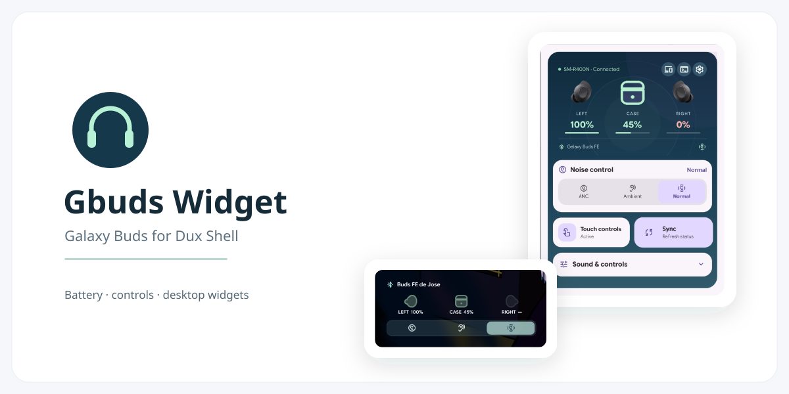
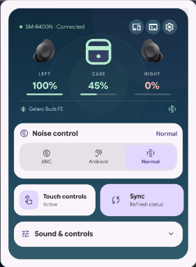
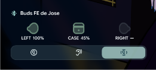
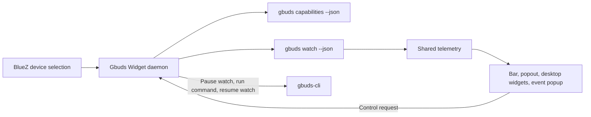

# Gbuds Widget

A Dux Shell 2.0 plugin for Galaxy Buds. It adds a status item to the bar, a control popout, a contextual event popup, and two desktop widget layouts. **[gbuds-cli](https://github.com/JessVolet/gbuds-cli/tree/main) is required**: this project does not communicate with the earbuds on its own.

| Control popout | Compact desktop widget |
| :---: | :---: |
|  |  |

## What it does

- Shows each earbud's and the case's battery and placement, plus the current noise mode.
- Offers noise control, touch lock, equalizer, ambient volume, voice detection, and Blade Lights **only when the connected model and CLI report support**.
- Shows a floating square popup for connection, placement, noise-mode, and low-battery changes. It selects the affected earbud, case, or mode icon.
- Provides full and compact desktop layouts. Add two instances to use both; they share live state and disappear when disconnected. The compact layout includes a noise-mode switcher.
- Lets you select among paired Buds and configure the CLI path, bar appearance, desktop layout, and popup.

## Requirements and installation

1. Install [Dux Shell 2.0 or newer](https://duxlabs.dev/docs/dms/plugin-development).
2. Install **[gbuds-cli](https://github.com/JessVolet/gbuds-cli/tree/main)** and complete its [BlueZ/Bluetooth setup](https://github.com/JessVolet/gbuds-cli/blob/main/docs/INSTALLATION.md). Check that `gbuds --help` works in the same environment as Dux Shell. You can set an absolute **Gbuds executable** path in plugin settings if it is not on Dux Shell's `PATH`.
3. Install Gbuds Widget from the Dux plugin registry when listed, or clone this repository into `~/.config/dms/plugins/gbudsWatch` and enable it in **DMS Settings → Plugins**. Keep the directory/id `gbudsWatch`; the display name is **Gbuds Widget**.
4. Add the bar widget and/or desktop widget from Dux settings. Open the bar item for controls. A uniquely connected Buds device is selected automatically; choose a device in the popout when several are paired.

The desktop widget is intentionally invisible while disconnected. The bar item remains available to open the popout and troubleshoot the connection.

## Device support

The widget gets device capabilities from the installed `gbuds-cli` version. This table describes the CLI's current model declarations, **not a promise that every widget control, firmware version, or Bluetooth transport has been verified**. See the [CLI's detailed support matrix](https://github.com/JessVolet/gbuds-cli/blob/main/docs/DEVICE_SUPPORT.md).

| Model | Code | Status here |
| --- | --- | --- |
| Galaxy Buds FE | SM-R400N | Physically tested for battery/status and live watch |
| Galaxy Buds3 | SM-R530 | Physically tested for battery/status and live watch |
| Galaxy Buds+ | SM-R175 | Declared by CLI; not physically tested with this widget |
| Galaxy Buds Live | SM-R180 | Declared by CLI; not physically tested with this widget |
| Galaxy Buds Pro | SM-R190 | Declared by CLI; not physically tested with this widget |
| Galaxy Buds2 | SM-R177 | Declared by CLI; not physically tested with this widget |
| Galaxy Buds2 Pro | SM-R510 | Declared by CLI; not physically tested with this widget |
| Galaxy Buds3 Pro | SM-R630 | Declared by CLI; not physically tested with this widget |
| Galaxy Buds3 FE | SM-R420 | Declared by CLI; not physically tested with this widget |
| Galaxy Buds4 | SM-R540 | Declared by CLI; not physically tested with this widget |
| Galaxy Buds4 Pro | SM-R640 | Declared by CLI; not physically tested with this widget |

The original Galaxy Buds (SM-R170) are recognized by the CLI but **cannot be used yet** because their legacy packet framing is not implemented. Physical tests on FE and Buds3 covered status/watch, not every control command. Other models need community hardware validation; missing artwork falls back to an icon.

## How it works

One daemon owns the CLI connection and shares its telemetry with every UI surface. When you press a control, the daemon pauses the watcher, runs one CLI command, updates the UI from its response, and resumes watching. This avoids competing Bluetooth RFCOMM sessions. [Architecture details](docs/ARCHITECTURE.md) and [development/testing instructions](docs/DEVELOPMENT.md) are available for contributors.

## Contributions and AI disclosure

This project was developed with AI assistance for QML implementation, documentation, and presentation layout. The UI screenshots show the actual running plugin; the presentation graphic is a simple layout built from those screenshots. AI output still needs human review and hardware testing. **Modifications and improvements are welcome**, especially model-specific testing, accessibility, translations, and visual refinements. Please include the Buds model code, firmware version, and what you tested when reporting compatibility; remove Bluetooth addresses or serial numbers from shared logs.

`gbuds-cli` is a separate required project, based on protocol research and specifications from [GalaxyBudsClient](https://github.com/timschneeb/GalaxyBudsClient). Earbud renders copied from GalaxyBudsClient are credited in [assets/README.md](assets/README.md); they have separate GPL-3.0 provenance. The widget's QML and documentation are MIT-licensed; see [LICENSE](LICENSE) and [LICENSE-GPL-3.0](LICENSE-GPL-3.0).
