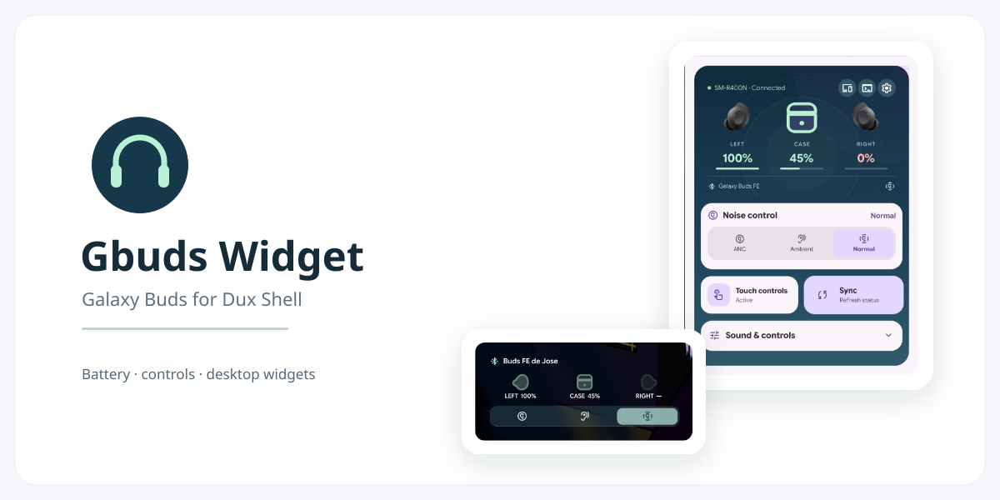
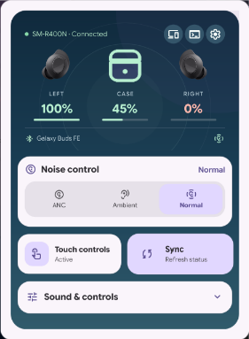
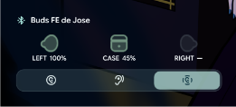
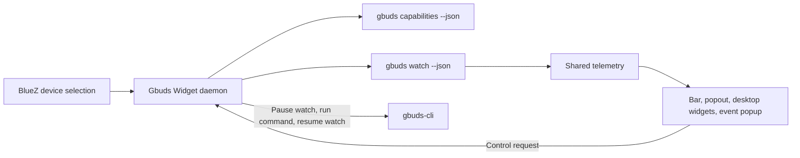

# Gbuds Widget

A Dux Shell 2.0 plugin for Galaxy Buds. It adds a status item to the bar, a control popout, animated Popup/Waveup alerts, and configurable desktop widgets. **[gbuds-cli](https://github.com/JessVolet/gbuds-cli/tree/main) is required**: this project does not communicate with the earbuds on its own.

| Control popout | Compact desktop widget |
| :---: | :---: |
|  |  |

## What it does

The `rewrite/modular-widget` branch is the 0.7.0-dev.7 testing candidate. It replaces the
legacy UI and daemon with reusable controllers under `src/`, retaining the approved
artwork in `assets/approved/`. The screenshots above show the earlier presentation.
See [rewrite status](tasks/rewrite/status.md) and [development commands](docs/DEVELOPMENT.md).

- Shows each earbud's and the case's battery and placement, plus the current noise mode.
- Offers noise control, touch lock, equalizer, ambient volume, voice detection, and Blade Lights **only when the connected model and CLI report support**.
- Provides Compact, Minimal, Detailed, and Custom desktop layouts. Each instance has its own visibility, artwork, block selection, spacing, size, style, and screen settings.
- Hides a disconnected desktop widget by default. You can instead show a Connect action or a read-only status. The bar and popout remain independent.
- Provides concurrent stacked Popup cards and repeating Waveups from the selected monitor corner. Choose a global Popup/Waveup/Both style, with per-event overrides under Advanced; match left/right placement and select SVG or device renders.
- Reports 50% battery as a soft amber pattern and 20% as a stronger red pattern. Optional out-of-ear reminders repeat on a configurable timer and cancel when the earbud is worn, stored, or disconnected.
- Select which monitors display each widget instance and synchronize or keep each position independent. A lock-screen copy is read-only by default and has independent settings.
- Lets you select among paired Buds and configure the CLI path and bar appearance.

## Requirements and installation

1. Install [Dux Shell 2.0 or newer](https://duxlabs.dev/docs/dms/plugin-development).
2. Install **[gbuds-cli](https://github.com/JessVolet/gbuds-cli/tree/main)** and complete its [BlueZ/Bluetooth setup](https://github.com/JessVolet/gbuds-cli/blob/main/docs/INSTALLATION.md). Check that `gbuds --help` works in the same environment as Dux Shell. You can set an absolute **Gbuds executable** path in plugin settings if it is not on Dux Shell's `PATH`.
3. Install Gbuds Widget from the Dux plugin registry when listed, or clone this repository into `~/.config/dms/plugins/gbudsWatch` and enable it in **DMS Settings → Plugins**. Keep the directory/id `gbudsWatch`; the display name is **Gbuds Widget**.
4. Add the bar widget and/or desktop widget from Dux settings. Open the bar item for controls. A uniquely connected Buds device is selected automatically; choose a device in the popout when several are paired.

The desktop widget is hidden while disconnected by default. In the settings for a widget instance, choose **Mostrar Conectar** or **Mostrar estado** if preferred. The bar item remains available to open the popout.

## Device support

The widget gets device capabilities from the installed `gbuds-cli` version. This table describes the CLI's current model declarations, **not a promise that every widget control, firmware version, or Bluetooth transport has been verified**. See the [CLI's detailed support matrix](https://github.com/JessVolet/gbuds-cli/blob/main/docs/DEVICE_SUPPORT.md).

| Model | Code | Status here |
| --- | --- | --- |
| Galaxy Buds FE | SM-R400N | Physically tested for battery/status and live watch |
| Galaxy Buds3 | SM-R530 | Physically tested for battery/status and live watch |
| Galaxy Buds+ | SM-R175 | Declared by CLI; not physically tested with this widget |
| Galaxy Buds Live | SM-R180 | Declared by CLI; not physically tested with this widget |
| Galaxy Buds Pro | SM-R190 | Declared by CLI; not physically tested with this widget |
| Galaxy Buds2 | SM-R177 | Declared by CLI; not physically tested with this widget |
| Galaxy Buds2 Pro | SM-R510 | Declared by CLI; not physically tested with this widget |
| Galaxy Buds3 Pro | SM-R630 | Declared by CLI; not physically tested with this widget |
| Galaxy Buds3 FE | SM-R420 | Declared by CLI; not physically tested with this widget |
| Galaxy Buds4 | SM-R540 | Declared by CLI; not physically tested with this widget |
| Galaxy Buds4 Pro | SM-R640 | Declared by CLI; not physically tested with this widget |

The original Galaxy Buds (SM-R170) are recognized by the CLI but **cannot be used yet** because their legacy packet framing is not implemented. Physical tests on FE and Buds3 covered status/watch, not every control command. Other models need community hardware validation; missing artwork falls back to an icon.

## How it works

One daemon owns the CLI connection and shares its telemetry with every UI surface. When you press a control, the daemon pauses the watcher, runs one CLI command, updates the UI from its response, and resumes watching. This avoids competing Bluetooth RFCOMM sessions. [Architecture details](docs/ARCHITECTURE.md) and [development/testing instructions](docs/DEVELOPMENT.md) are available for contributors.

Click an out-of-ear L/R icon in the desktop widget or popout to find that earbud;
click it again to stop. A search requests Stop after 30 seconds. **Desconectar**
under CASE stops any active search before disconnecting. Offline, the widget
is hidden by default; optional **Conectar** uses the last selected device. Each reconnection refreshes
`capabilities`, and unsupported noise modes stay hidden. Capability metadata is
not proof of a physical test; the CLI currently leaves Find support unclassified.

## Contributions and AI disclosure

This project was developed with AI assistance for QML implementation, documentation, and presentation layout. The UI screenshots show the actual running plugin; the presentation graphic is a simple layout built from those screenshots. AI output still needs human review and hardware testing. **Modifications and improvements are welcome**, especially model-specific testing, accessibility, translations, and visual refinements. Please include the Buds model code, firmware version, and what you tested when reporting compatibility; remove Bluetooth addresses or serial numbers from shared logs.

`gbuds-cli` is a separate required project, based on protocol research and specifications from [GalaxyBudsClient](https://github.com/timschneeb/GalaxyBudsClient). Earbud renders copied from GalaxyBudsClient are credited in [assets/README.md](assets/README.md); they have separate GPL-3.0 provenance. The widget's QML and documentation are MIT-licensed; see [LICENSE](LICENSE) and [LICENSE-GPL-3.0](LICENSE-GPL-3.0).

## Native panel and notification rules

The expanded panel includes contextual Find hints, an in-memory command history (80 entries), a target-specific output mixer, supported sound controls and connection management. Header actions use system icons and the canonical Dux settings route.

Open Gbuds settings → Notifications. Choose the default style, enable Advanced notifications, then select an event. For the requested example choose Noise mode changed → Popup → Center. Reset restores inheritance; disabling Advanced keeps the exceptions saved but inactive. Preview uses simulated events, never hardware controls. Custom popup positions do not change Waveup corner origins.

The Applications mixer explicitly lists all playback streams. Bluetooth output identity must be unique before the main mixer is enabled. Existing custom colors and presentation preferences are preserved; new configurations default to Waveups. The native controls honor the Dux theme and reduced-motion setting.
