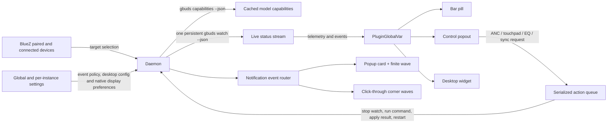

# Architecture

Gbuds Widget is a composite Dux Shell plugin. One daemon owns Gbuds CLI processes and publishes shared state to the bar, popout, and desktop surfaces.

## Device selection

The daemon follows a uniquely connected Galaxy Buds device detected by Dux Shell. If more than one is paired, the popout lists the paired Buds; selecting one asks BlueZ to connect it, persists its address, and passes that target to Gbuds using `--mac`. A uniquely connected device is followed automatically so switching between paired models updates the active stream.

`gbuds capabilities --json` supplies model code, color, supported noise modes, and device name from cached BlueZ metadata. It runs alongside the watcher so telemetry does not wait for a second RFCOMM connection. These fields choose an available GalaxyBudsClient render and filter controls. Models without a copied render use Material icons.

## Watch lifecycle and actions

The daemon starts one `gbuds watch --json` process only while BlueZ reports a connected Buds device. Each newline-delimited JSON object updates shared telemetry. If the process exits while the device remains connected, Gbuds Widget keeps the last sample and retries with exponential backoff up to 30 seconds. It stops retrying when the Buds disconnect and resumes on the next BlueZ connection change.

Control requests enter a serialized queue. The daemon stops the watch process first, then runs exactly one `gbuds --json <command>` process. It publishes the command and response, applies returned state immediately, and resumes the watch without another metadata lookup. This avoids running two CLI RFCOMM sessions at once. Find Stop has priority and cancels pending search starts. Disconnect first stops an active search; if Stop fails, that disconnect is canceled. A successful disconnect clears stale status and pending controls, and suppresses watcher recovery until an explicit or external reconnection.

`capabilities` is refreshed for each new connection, not sent as a control action.
Explicit unsupported/not-implemented features are excluded. Unclassified
Find/Touchpad/EQ declarations remain distinct from confirmed model support.
Find is offered only for `IDLE` ears, has an explicit Stop state, and requests Stop
after 30 seconds or an incoming placement change. A timed-out start retains Stop
because its Bluetooth packet may already have reached the earbuds.

## Notification event pipeline

`core-v060/NotificationPolicy.js` converts each watch sample into an event list. It keeps simultaneous battery, placement, and mode changes, snapshots the affected model/status before disconnect cleanup, combines simultaneous left/right events, and applies 5-point battery hysteresis. Battery alerts trigger on downward crossings of 50% and 20%; a jump from 59% to 18% emits only the urgent crossing.

The single daemon routes events through a global Popup/Waveup/Both preference with optional per-event overrides. Concurrent Popup events stack as separate cards in one corner; compact secondary cards promote to the main card without a gap. Waveup patterns repeat at a configurable interval for a finite duration, and simultaneous events rotate through a bounded queue. Both formats retain event identity, side, tone, wave count, artwork, selected screen, and top/bottom placement. R/L events follow their side; pair/noise events use both edges; case events use the configured fixed side. An SVG remains the fallback when a model render is missing. Simulated preview events use a separate global variable and never call Gbuds CLI.

Two daemon timers can repeat out-of-ear reminders independently. Placement changes and disconnect cleanup stop the corresponding timer; if both ears are out, their next reminders share a bilateral event.

## UI surfaces

- **Bar pill:** configurable battery layout, out-of-ear warning, and noise-mode icon; disconnected devices show only a disconnected icon.
- **Control popout:** full-panel gradient, model renders, per-part battery, supported noise modes, touch controls, a collapsible sound list, and separate device/settings/console views without scrolling.
- **Desktop widget:** per-instance Compact, Minimal, Detailed, and Custom compositions. New instances start Compact with SVG artwork and hide while disconnected; optional offline policies show Connect or read-only status. Per-instance controls cover blocks, spacing, sizes, background, orientation, and monitor preferences. Dux owns per-screen geometry and placement synchronization. Lock-screen copies are independently configured, hidden offline, and read-only unless noise controls are explicitly enabled.

Every control is capability-filtered or disabled when disconnected. Status remains read-only telemetry; user actions invoke the installed Gbuds CLI.
