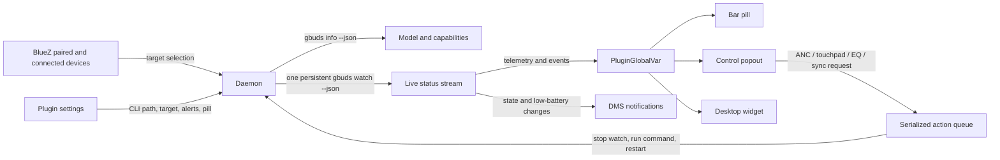

# Architecture

Gbuds Watch is a composite Dux Shell plugin. One daemon owns Gbuds CLI processes and publishes shared state to the bar, popout, and desktop surfaces.

## Device selection

The daemon follows a uniquely connected Galaxy Buds device detected by Dux Shell. If more than one is paired and none is uniquely connected, the popout lists the paired Buds and lets the user select the target. The selected address is persisted and passed to Gbuds using `--mac`. A subsequent uniquely connected device takes precedence so switching from one paired Buds model to another can follow the active device.

`gbuds info --json` supplies model code, color, supported noise modes, and device name. These fields choose an available GalaxyBudsClient render and filter noise controls. Models without a copied render use Material icons.

## Watch lifecycle and actions

The daemon starts one `gbuds watch --json` process. Each newline-delimited JSON object updates shared telemetry. When the process exits, Gbuds Watch keeps the last sample visible and retries with exponential backoff up to 15 seconds.

Control requests enter a FIFO queue. The daemon stops the watch process first, then runs exactly one `gbuds --json <command>` process. It publishes the command and response for the collapsible output drawer, displays success/error feedback, and resumes device metadata lookup and watch. This avoids running two CLI RFCOMM sessions at once.

## State and notifications

The `telemetry` global variable contains `phase`, `detail`, `status`, `event`, and `updatedAt`. Additional globals hold device metadata, selected MAC, current command state, and the last command response. State-change alerts observe placement, battery, noise control, EQ, and touchpad state. Low-battery alerts fire when a battery crosses the configured threshold and are rate-limited.

## UI surfaces

- **Bar pill:** compact, minimal, or detailed battery and noise-mode summary.
- **Control popout:** large model renders, per-part battery, supported ANC modes, touchpad, EQ, device selection, quick settings, and a hidden-by-default CLI output drawer.
- **Desktop widget:** the same controls and live state in a resizable card.

Every control is capability-filtered or disabled when disconnected. Status remains read-only telemetry; user actions invoke the installed Gbuds CLI.
