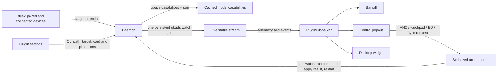

# Architecture

Gbuds Watch is a composite Dux Shell plugin. One daemon owns Gbuds CLI processes and publishes shared state to the bar, popout, and desktop surfaces.

## Device selection

The daemon follows a uniquely connected Galaxy Buds device detected by Dux Shell. If more than one is paired, the popout lists the paired Buds; selecting one asks BlueZ to connect it, persists its address, and passes that target to Gbuds using `--mac`. A uniquely connected device is followed automatically so switching between paired models updates the active stream.

`gbuds capabilities --json` supplies model code, color, supported noise modes, and device name from cached BlueZ metadata. It runs alongside the watcher so telemetry does not wait for a second RFCOMM connection. These fields choose an available GalaxyBudsClient render and filter controls. Models without a copied render use Material icons.

## Watch lifecycle and actions

The daemon starts one `gbuds watch --json` process. Each newline-delimited JSON object updates shared telemetry. When the process exits, Gbuds Watch keeps the last sample in memory and retries with exponential backoff up to 3 seconds.

Control requests enter a FIFO queue. The daemon stops the watch process first, then runs exactly one `gbuds --json <command>` process. It publishes the command and response, applies returned state immediately, and resumes the watch without another metadata lookup. This avoids running two CLI RFCOMM sessions at once.

## State cards

The `telemetry` global variable contains the latest status and a transient `latestEvent`. The daemon creates events only for connection, earbud placement, noise-mode, and 30% / 10% battery transitions. Each event carries a subject (`left`, `right`, `case`, `pair`, or `mode`) so the square floating surface shows only the relevant artwork. The surface appears in the chosen screen corner for the selected duration, independently of the popout and desktop widget boundaries. No DMS notification toast is emitted.

## UI surfaces

- **Bar pill:** configurable battery layout, out-of-ear warning, and noise-mode icon; disconnected devices show only a disconnected icon.
- **Control popout:** full-panel gradient, model renders, per-part battery, supported noise modes, touch controls, a collapsible sound list, and separate device/settings/console views without scrolling.
- **Desktop widget:** each instance selects a full controls layout or a compact status layout with a capability-filtered noise-mode switcher. Both share daemon telemetry; their layout setting is stored per instance. Their outer surface fades away and stops accepting input while disconnected.

Every control is capability-filtered or disabled when disconnected. Status remains read-only telemetry; user actions invoke the installed Gbuds CLI.
