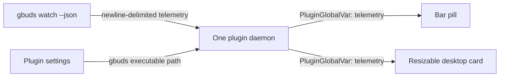

# Architecture

Gbuds Watch is a Dux Shell 2.0 composite plugin with three surfaces:



The daemon is the only component that opens the Bluetooth RFCOMM stream. The bar widget and desktop widget observe the daemon's `telemetry` global variable; neither starts a second CLI process. This avoids competing Gbuds sessions and keeps both surfaces synchronized.

## Telemetry contract

`gbuds watch --json` emits one JSON object per line. Gbuds Watch consumes the status fields `left`, `right`, `case`, charging flags, placement fields, `noise_control`, `equalizer`, and `touchpad_locked`.

The daemon publishes:

```json
{
  "phase": "connected",
  "detail": "",
  "status": { "left": 97, "right": 96, "case": 75 },
  "event": "Noise control: AMBIENT SOUND",
  "updatedAt": 1793200000000
}
```

Phases are `checking-cli`, `missing-cli`, `connecting`, `connected`, and `waiting`. On process exit, the daemon preserves the last sample for context, marks the connection as waiting, and retries with exponential backoff up to 15 seconds.

## Scope of the first slice

This implementation is a live status display. The supplied HTML prototype also includes control actions and transient notification cards. Those actions need a coordinated stop-command-restart flow around the persistent RFCOMM watcher, so they are intentionally kept out of the initial telemetry slice until the read-only watch integration is verified with the user's Buds.
